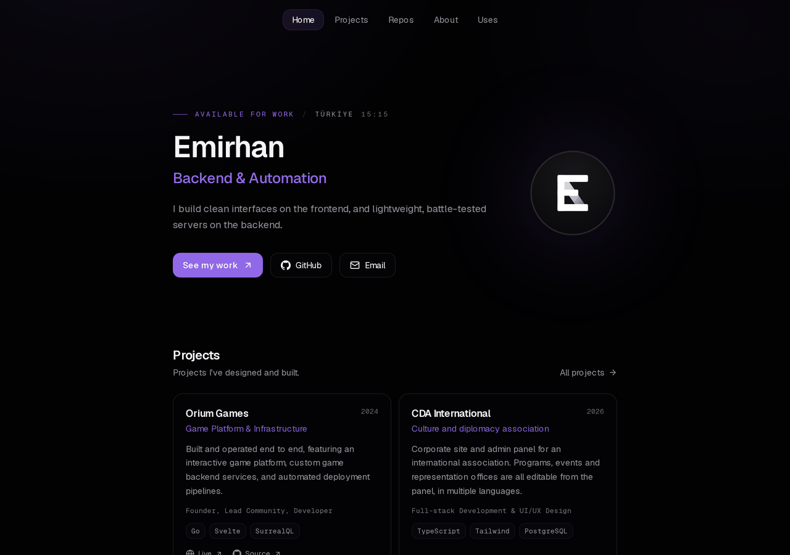
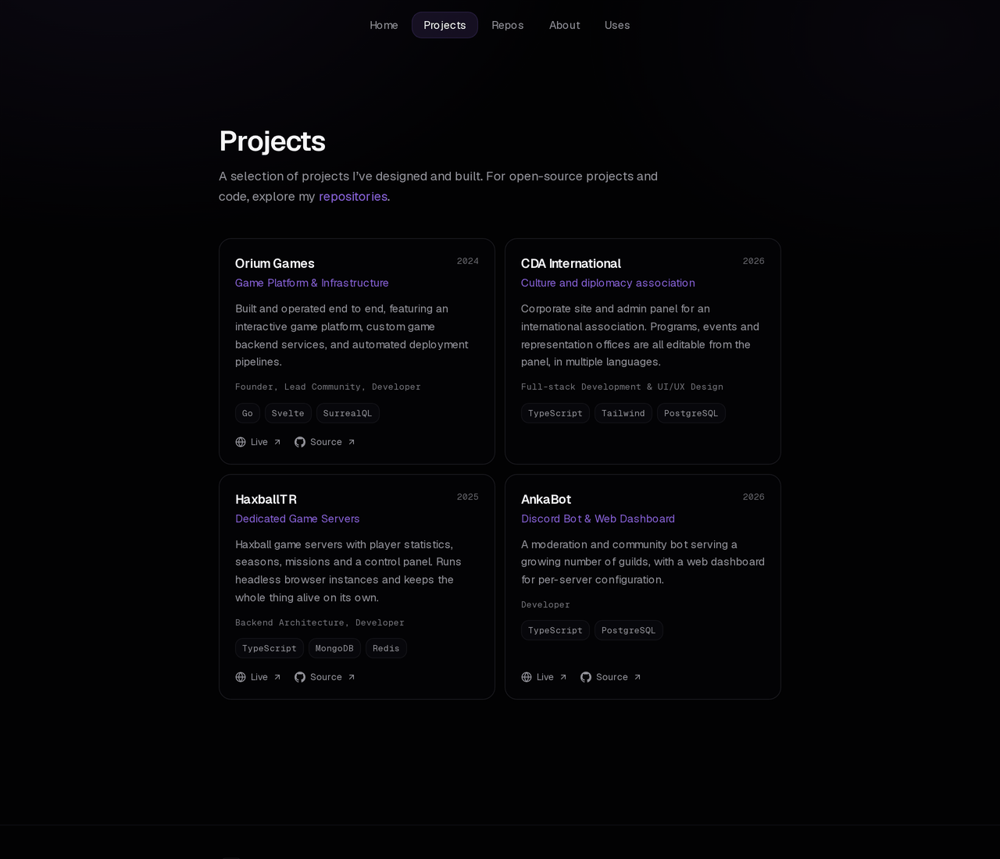
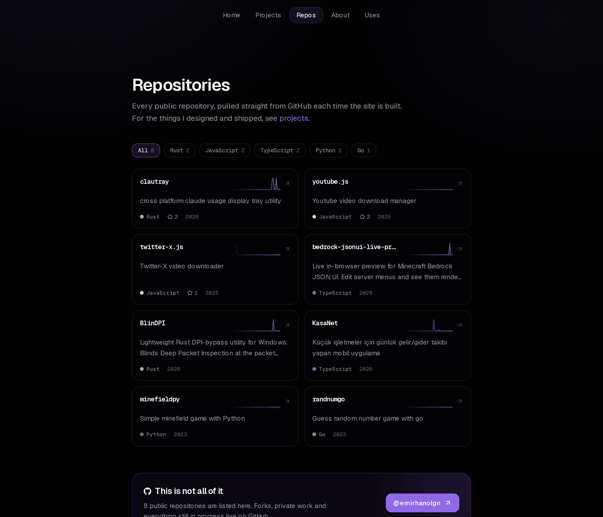
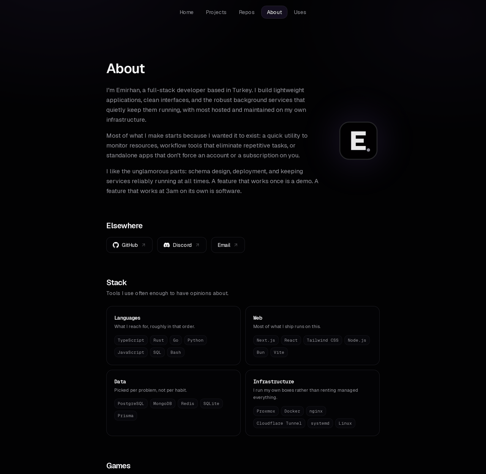

<div align="center">


# website

**Personal site. Statically exported Next.js, deployed to GitHub Pages.**

[**emirhan.lol**](https://emirhan.lol)

[](https://github.com/EmirhanOlgn/website/actions/workflows/deploy.yml)




</div>

## Pages

| Route | What is on it |
| --- | --- |
| `/` | Intro, selected projects, contribution graph, stack |
| `/projects/` | Curated work, with live and source links |
| `/repositories/` | Every public repo, pulled from the GitHub API at build time |
| `/about/` | Bio, links, stack, games |
| `/uses/` | Editors, languages, infrastructure, data |

## How it works

The whole site is static. `output: "export"` writes plain HTML to `out/`, so
there is no runtime, no API routes and nothing to keep alive.

Repository data is not fetched in the browser. `scripts/fetch-repos.mjs` runs
before every build, reads the GitHub API and writes
`src/data/repos.generated.json`: name, description, language, stars and a year
of weekly commit counts for the sparklines. Forks, archived repos and the
profile repo are filtered out. If the API rate limits the run, the previous
file's activity is reused rather than blanked.

The contribution graph is the one exception. It is fetched on the client,
because a build-time fetch would show yesterday's squares until the next
deploy.

Colour lives in `globals.css` as OKLCH tokens under `@theme inline`. Dark is
the base and light is the override, not the other way round.

## Running it

```bash
npm install
npm run dev
```

Building writes `out/`:

```bash
npm run build
```

Set `GITHUB_TOKEN` in the environment to lift the API ceiling from 60 to 1000
requests an hour. Without one the build still works, it just reuses cached
activity when it runs out.

## Deploying

`.github/workflows/deploy.yml` builds on every push to `main` and publishes
`out/` with `actions/deploy-pages`. It needs **Settings → Pages → Source:
GitHub Actions**; the "Deploy from a branch" setting ignores the workflow
entirely.

The custom domain is set under the same Pages settings, not in a `CNAME` file.
With an Actions deploy GitHub ignores that file, so the repository does not
carry one.

## Screenshots

<details>
<summary><b>Projects</b></summary>

</details>

<details>
<summary><b>Repositories</b></summary>

</details>

<details>
<summary><b>About</b></summary>

</details>

## Brand

<table>
<tr>
<td align="center" width="200"></td>
<td align="center" width="200"></td>
</tr>
<tr>
<td align="center"><code>public/brand/mark.svg</code></td>
<td align="center"><code>public/brand/logo.svg</code></td>
</tr>
<tr>
<td align="center"><sub>Favicon and the hero.<br>Needs 40px or more to read.</sub></td>
<td align="center"><sub>Everywhere else,<br>including small sizes.</sub></td>
</tr>
</table>

## Structure

```
src/
  app/           routes, one directory per page
  components/
    layout/      nav, footer
    sections/    home page sections
    ui/          cards, motion primitives, icons
  data/          site, work, uses, stack, games, generated repos
scripts/
  fetch-repos.mjs   runs before every build
public/
  brand/         logo and mark
  games/         cover art for the about page
```

## License

MIT. Take what is useful, keep the notice.
